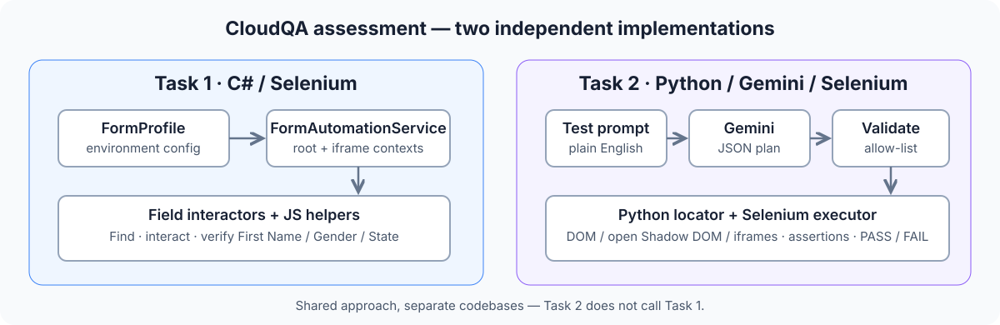

# CloudQA Practical Assessment

Two implementations for the CloudQA assessment. Both automate browsers with Selenium, but they are **independent projects**.



## How the two tasks relate

| | Task 1 | Task 2 |
|---|---|---|
| Purpose | Fill and verify three known form fields | Turn a plain-English test into a browser workflow |
| Stack | C#, .NET 10, Selenium | Python, Gemini, Selenium |
| Planning | Fixed profile from environment variables | Gemini generates a JSON action plan |
| Execution | C# field interactors + JavaScript helpers | Python action executor + Python-defined JavaScript locator |
| Output | Per-context field verification summary | Workflow PASS / FAIL and failure screenshot |

**Important:** Task 2 does not import, call, or reuse Task 1's C# classes. The implementations share an approach—semantic element discovery and verification—not code. They can be run and understood separately.

## Repository layout

- [task1-dotnet/](task1-dotnet/) — adaptive form automation for First Name, Gender and State.
- [task2-agent/](task2-agent/) — natural-language browser testing agent powered by Gemini.
- [assets/](assets/) — architecture diagrams used in these docs.

## Quick start

### Task 1 — C# / Selenium

Requires .NET SDK 10 and Google Chrome.

```powershell
$env:TARGET_URL = "https://app.cloudqa.io/home/AutomationPracticeForm"
$env:FIRST_NAME = "Vaishnav"
$env:GENDER = "Male"
$env:STATE = "Maharashtra"
dotnet run --project .\cloudqa\task1-dotnet\AdaptiveFormAutomation.csproj
```

### Task 2 — Python / Gemini / Selenium

Requires Python 3.10+, Google Chrome, and a Gemini API key.

```powershell
cd cloudqa/task2-agent
pip install -r requirements.txt
$env:GEMINI_API_KEY = "your-api-key"
python agent.py --url https://phptravels.com/demo --test "Verify that the demo request form is displayed"
```

Add `--headed` to show the browser window.

## Presentation

Open the [CloudQA browser presentation](presentation/index.html). Use the left/right arrow keys to navigate, press `F` for fullscreen, or print to PDF.

## Detailed guides

- [Task 1 architecture, setup and limitations](task1-dotnet/README.md)
- [Task 2 architecture, setup and limitations](task2-agent/README.md)

These are assessment prototypes; compatibility depends on the target page's accessible DOM and widget behavior.
