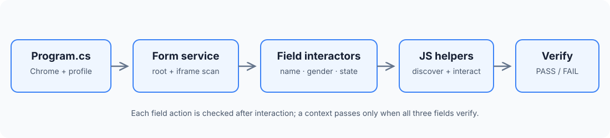

# Task 1: Resilient Form Automation

Automates three fields on the CloudQA Automation Practice Form:

- **First Name** — text input
- **Gender** — radio option
- **State** — dropdown

## Architecture



### What each part does

1. **Program.cs** loads the target URL and form values from environment variables, then starts Chrome.
2. **FormAutomationService** checks the root document and recursively visits iframe contexts (up to four levels).
3. **Field interactors** handle First Name, Gender and State independently.
4. **ResilientEngineScripts** contains JavaScript used to discover controls through the standard DOM and accessible open Shadow DOMs, then interact with and verify them.
5. A context is recorded as passed only when all three field operations complete and verify.

## Key techniques

- Semantic matching using labels, ARIA attributes, names, placeholders and visible text.
- Open Shadow DOM traversal; closed shadow roots are not accessible.
- Iframe discovery without depending on frame IDs, bounded to four levels.
- Geometry-based proximity fallback when semantic relationships are missing.
- Native Selenium interaction first, with JavaScript fallback where needed.
- Explicit checks after filling or selecting values.

## Run

Requires .NET SDK 10 and Google Chrome. From the repository root, use PowerShell:

```powershell
$env:TARGET_URL = "https://app.cloudqa.io/home/AutomationPracticeForm"
$env:FIRST_NAME = "Vaishnav"
$env:GENDER = "Male"
$env:STATE = "Maharashtra"
$env:HEADLESS = "0" # Omit or set to 1 for headless mode

dotnet run --project .\cloudqa\task1-dotnet\AdaptiveFormAutomation.csproj
```

## Scope and limitations

The implementation is designed for the assessment's form and controlled DOM variations. It supports native selects and custom dropdowns whose opened options are exposed in the accessible DOM. Closed Shadow DOMs, inaccessible cross-origin frames and highly bespoke widgets may require additional handling.

Task 1 is a standalone C# implementation. Task 2 is a separate Python agent; it does not call this project's classes or scripts.
