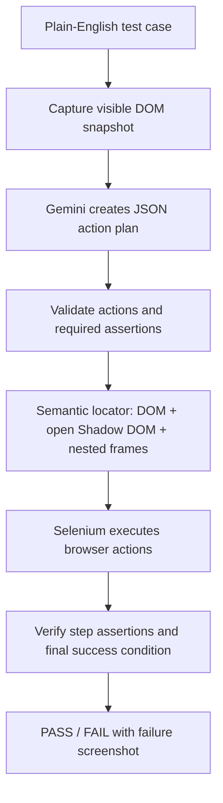

# Task 2: Plain-English Automated Browser Test Agent

## Problem Statement
Build an autonomous browser agent that accepts plain-English test descriptions (e.g. *"Log in as customer and verify dashboard"*, *"Verify that the demo request form is displayed with First Name, Last Name, Business Name and Email fields"*), executes them automatically in a browser, and reports a verifiable **Pass / Fail** result. The tool avoids site-specific selectors, but successful automation depends on the target site's accessible structure and the quality of the generated plan.

---

## Tech Stack & Architecture
- **Language**: Python 3.10+
- **Automation Engine**: Selenium WebDriver (Chrome)
- **AI Planning Engine**: Google Gemini via official `google-genai` SDK (`gemini-2.5-flash` with multi-model fallback and auto-retries)
- **Execution Resilience Engine**: Semantic matching using accessible labels, ARIA attributes, roles, placeholders and visible text; open Shadow DOM traversal; recursive iframe search (bounded to four levels); native and accessible custom-dropdown handling.

---

## How It Works



---

## Setup & Running

### 1. Install Dependencies
```bash
cd cloudqa/task2-agent
pip install -r requirements.txt
```

### 2. Configure Environment
Set `GEMINI_API_KEY` in `cloudqa/task2-agent/.env` or export it:
```bash
# Windows PowerShell:
$env:GEMINI_API_KEY="your-api-key"
```

### 3. Run Tests
**Run on PHPTRAVELS Demo:**
```bash
python agent.py --url https://phptravels.com/demo --test "Verify that the demo request form is displayed with First Name, Last Name, Business Name and Email fields"
```

**Run against another site (compatibility depends on its accessible DOM):**
```bash
python agent.py --url https://example.com --test "Verify that More information link is present on the page"
```
Add `--headed` to run in a visible browser window.

## Test strategy and limitations

Run deterministic planner-contract unit tests (no browser, network, or Gemini key required):

```bash
cd cloudqa/task2-agent
pip install -r requirements.txt
pip install pytest
pytest -q
```

The tests above validate the action-plan schema and mandatory final assertion. They are not browser integration tests. To run an end-to-end test, install Chrome, configure `GEMINI_API_KEY`, and execute one of the commands above. That integration run requires internet access and available Gemini API quota.

The agent supports the standard DOM, accessible open Shadow DOMs, and nested iframes up to four levels. Closed shadow roots, inaccessible cross-origin content, canvas-only controls, and custom widgets without discoverable accessible options cannot be reliably automated. A custom dropdown is considered successful only when the selected value or selected accessible option can be verified. The LLM-generated plan is treated as untrusted input and restricted to the allow-listed browser actions; do not use this agent on sites where test actions could cause irreversible changes.
