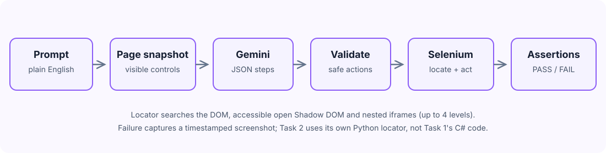

# Task 2: Plain-English Automated Browser Test Agent

Give the agent a test instruction in plain English. It inspects the page, asks Gemini to produce a structured action plan, executes that plan in Chrome, and checks whether the expected result appeared.

## Architecture



### Execution flow

1. **Input:** Receives a target URL and plain-English test case.
2. **Snapshot:** Inspects visible controls and page context, including accessible open Shadow DOM and nested frames.
3. **Planning:** Gemini returns a structured JSON list of browser actions.
4. **Validation:** Rejects malformed plans, unsupported actions, missing targets/values, and plans without assertions.
5. **Execution:** Python runs the allow-listed actions using Selenium and its own semantic JavaScript locator.
6. **Verification:** Checks step assertions and the final success condition. Reports PASS / FAIL; saves a timestamped screenshot on failure.

> **Note:** Task 2 does not use Task 1's C# implementation. Its locator and executor are implemented independently in `agent.py`.

## Tech Stack

- **Python 3.10+**
- **Selenium WebDriver** with Chrome
- **Google Gemini** through the official `google-genai` SDK
- **python-dotenv** for local environment configuration

## Run

### 1. Install dependencies

```bash
cd task2-agent
pip install -r requirements.txt
```

### 2. Set the Gemini API key

Windows PowerShell:

```powershell
$env:GEMINI_API_KEY = "your-api-key"
```

Or put it in a local `.env` file in the `task2-agent` directory.

### 3. Start a test

```powershell
python agent.py --url https://phptravels.com/demo --test "Verify that the demo request form is displayed with First Name, Last Name, Business Name and Email fields" --headed
```

## Unit Tests

The deterministic planner-contract tests do not launch Chrome or consume Gemini quota:

```bash
pip install pytest
pytest -q
```

## Scope and Limitations

- **DOM Accessibility**: Supports standard DOM, open Shadow DOM, and nested iframes up to 4 levels. Closed shadow roots, cross-origin restricted frames, and canvas-only controls cannot be automated.
- **Allow-Listed Action Set**: The agent executes within a strict whitelist (`navigate`, `click`, `fill`, `select`, `wait`, `assert_text`, `assert_visible`). Irreversible external actions and raw shell execution are prohibited by design.
- **Single-Turn Plan Generation**: The model plans against an initial DOM snapshot. Multi-page dynamic Single Page Application (SPA) state changes that render entirely new routes without page reloads require multi-turn conversational agents.
